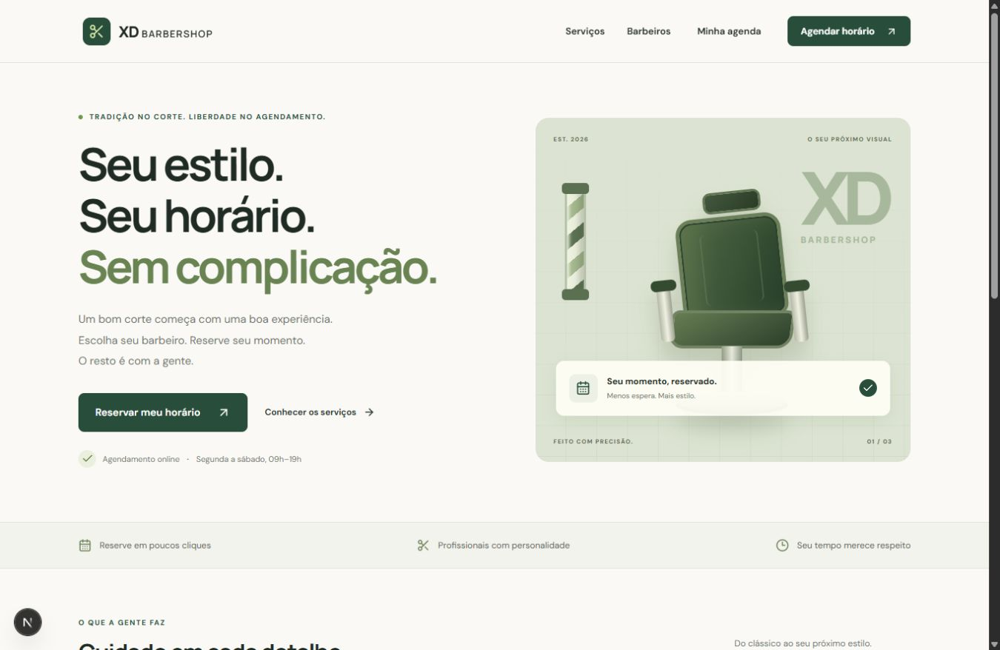
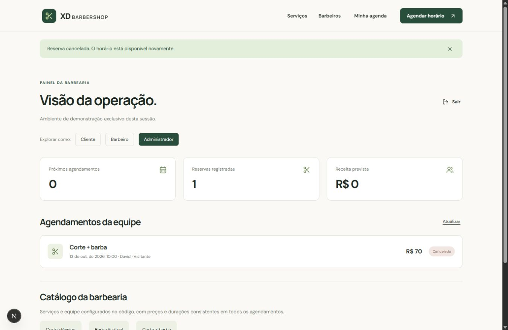
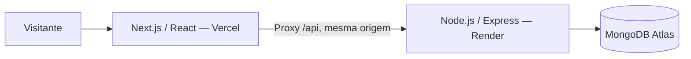

<div align="center">

# ✂️ XD Barbershop

### Seu estilo. Seu horário. Sem complicação.

Sistema de agendamento para uma barbearia fictícia, com experiência de cliente e painéis para a equipe.


[O produto](#o-produto) · [Para recrutadores](#para-recrutadores) · [Rodar localmente](#rodar-localmente) · [Publicação gratuita](#publicação-gratuita) · [Créditos](#créditos)

</div>



## O produto

Escolher um corte deveria ser fácil. Reservar um horário também.

O **XD Barbershop** reúne seleção de serviço, escolha do barbeiro, consulta de disponibilidade e confirmação de reserva. A equipe acompanha os agendamentos em um painel, e o cliente pode consultar e cancelar suas reservas futuras.

É um projeto público de portfólio. A barbearia, os preços e os profissionais são fictícios; não há pagamentos nem atendimento real. A aplicação foi preparada para Vercel, Render e MongoDB Atlas, mas a publicação depende da configuração dessas contas. Nenhuma URL de demonstração é anunciada antes de um deploy real.

## Para recrutadores

Este repositório permite avaliar uma aplicação completa, do React à persistência no MongoDB, com regras de negócio verificáveis. A validação local inicial passou em **8 testes** e na compilação de produção do Next.js.

| O que avaliar                                       | Onde encontrar                                           |
| --------------------------------------------------- | -------------------------------------------------------- |
| Experiência responsiva e fluxo de reserva           | `frontend/app/page.js` e `globals.css`                   |
| Validação e permissões no servidor                  | `backend/src/app.js`                                     |
| Reservas simultâneas e integridade dos horários     | `backend/src/models.js` e `backend/test/booking.test.js` |
| Horários, duração e disponibilidade                 | `backend/src/schedule.js`                                |
| Configuração para deploy e verificações automáticas | `render.yaml` e `.github/workflows/ci.yml`               |

**Roteiro para explorar em poucos minutos:**

1. Entre na demonstração como cliente.
2. Reserve um **Corte + barba**, que ocupa 60 minutos.
3. Veja a reserva no painel e alterne para administrador.
4. Volte ao cliente e confira que os dois intervalos de 30 minutos ficaram indisponíveis para o mesmo barbeiro.
5. Cancele a reserva e confira a liberação dos horários.
6. Leia o teste que dispara seis requisições simultâneas: somente uma pode reservar o mesmo horário.

Os perfis da demonstração compartilham a agenda **da mesma sessão**. Outro visitante recebe sua própria agenda. O barbeiro de demonstração representa David e vê apenas reservas atribuídas a ele.

<details>
<summary>Veja o painel da barbearia</summary>



</details>

## Funcionalidades implementadas

- Página inicial com identidade visual própria, serviços, equipe e créditos.
- Interface responsiva em português, com mensagens de erro, confirmação e carregamento.
- Cadastro e login de clientes; senha com bcrypt e sessão em cookie HttpOnly.
- Seleção de corte, barba ou combo; preço e duração definidos no servidor.
- Atendimento de segunda a sábado, das 09h às 19h, no fuso de São Paulo.
- Reservas futuras dentro de uma janela de 60 dias, em intervalos de 30 minutos.
- Bloqueio atômico de horários sobrepostos, inclusive para serviços de uma hora.
- Consulta e cancelamento de reservas futuras, com liberação dos horários.
- Cliente vê suas reservas; barbeiro vê sua agenda; administrador vê a operação.
- Demonstração opcional com troca de perfil, dados isolados por sessão e expiração em sete dias.
- Catálogo consultável no painel do administrador.
- Rate limiting, proteção de origem em operações de escrita, validação Zod e Helmet.
- Testes de integração com MongoDB temporário e pipeline no GitHub Actions.

## Arquitetura



O frontend e o backend vivem no mesmo repositório, usando npm workspaces, mas são publicados separadamente. O navegador acessa `/api` na origem do frontend; o Next.js encaminha para o Express. Isso mantém a sessão em cookie HttpOnly sem expor o segredo JWT ou a conexão do MongoDB ao navegador.

### Como uma reserva evita conflitos

Cada reserva contém os blocos de 30 minutos que o serviço ocupa. Um combo às 10h contém os blocos das 10h e 10h30. Um índice composto único sobre `scope`, `barberId` e `slots`, aplicado apenas às reservas confirmadas, impede que outra reserva ocupe qualquer desses blocos.

A criação usa uma única inserção atômica. A consulta de disponibilidade orienta a interface; **o índice do banco é a garantia final**, mesmo quando duas pessoas confirmam ao mesmo tempo. Um conflito retorna HTTP `409`. O cancelamento muda o status e retira a reserva do índice parcial, liberando os blocos. O servidor só começa a atender após criar os índices.

### Demonstração pública

O endpoint de demonstração cria uma identidade temporária e um escopo próprio. Ele não dá acesso administrativo aos dados reais. As reservas de demonstração têm um índice TTL de sete dias e um limite de 20 registros por sessão. A limpeza TTL é assíncrona; não acontece necessariamente no instante exato da expiração.

## Estrutura

```text
xd-barbershop/
├── frontend/
│   ├── app/               # App Router, interface e estilos
│   ├── next.config.mjs    # Proxy da API
│   └── .env.local.example
├── backend/
│   ├── src/               # Express, modelos, regras e catálogo
│   ├── test/              # Testes de integração
│   └── .env.example
├── .github/workflows/ci.yml
├── render.yaml
├── package.json           # Workspaces e comandos conjuntos
├── package-lock.json
├── LICENSE
└── README.md
```

## Rodar localmente

**Pré-requisitos:** Node.js 22 ou superior, npm e MongoDB local ou um cluster Atlas gratuito.

```bash
git clone https://github.com/davidxavierxdplanschat/xd-barbershop.git
cd xd-barbershop
npm ci
```

Copie `backend/.env.example` para `backend/.env` e `frontend/.env.local.example` para `frontend/.env.local`.

Configure no backend:

```dotenv
PORT=4000
MONGODB_URI=mongodb://127.0.0.1:27017/xd-barbershop
JWT_SECRET=um-segredo-aleatorio-de-pelo-menos-32-caracteres
FRONTEND_URL=http://localhost:3000
NODE_ENV=development
DEMO_ENABLED=true
```

Para gerar um segredo:

```bash
node -e "console.log(require('node:crypto').randomBytes(32).toString('hex'))"
```

No frontend, mantenha `API_URL=http://127.0.0.1:4000`. Não adicione `/api` ao final dessa URL.

```bash
npm run dev
```

- Interface: `http://localhost:3000`
- Saúde da API: `http://localhost:4000/api/health`

### Comandos

| Comando na raiz  | Ação                                                           |
| ---------------- | -------------------------------------------------------------- |
| `npm run dev`    | Inicia frontend e backend juntos                               |
| `npm test`       | Executa testes de regras e integração                          |
| `npm run build`  | Compila o frontend para produção                               |
| `npm run seed`   | Cria um administrador real, sem sobrescrever contas existentes |
| `npm run format` | Formata o código e a documentação com Prettier                 |

Os testes usam `mongodb-memory-server`, que baixa um binário MongoDB na primeira execução. Não usam o seu banco real nem exigem credenciais Atlas.

Para criar um administrador real, configure `ADMIN_EMAIL` e `ADMIN_PASSWORD` (12 a 72 caracteres) no backend e execute `npm run seed`. O cadastro público sempre cria clientes. Os perfis barbeiro e administrador são disponibilizados imediatamente na demonstração; o provisionamento de barbeiros reais ainda não tem interface.

## API

Todas as respostas são JSON, exceto logout (`204`). Operações de escrita exigem `Origin` igual a `FRONTEND_URL`. Rotas protegidas usam o cookie de sessão.

| Método | Rota                                                               | Uso                                         |
| ------ | ------------------------------------------------------------------ | ------------------------------------------- |
| GET    | `/api/health`                                                      | Saúde da API                                |
| GET    | `/api/catalog`                                                     | Serviços, profissionais e data local        |
| POST   | `/api/auth/register`                                               | Cadastro de cliente                         |
| POST   | `/api/auth/login`                                                  | Login                                       |
| POST   | `/api/auth/demo`                                                   | Demonstração: `client`, `barber` ou `admin` |
| GET    | `/api/auth/me`                                                     | Sessão atual                                |
| POST   | `/api/auth/logout`                                                 | Encerrar sessão                             |
| GET    | `/api/availability?serviceId=corte&barberId=david&date=AAAA-MM-DD` | Horários disponíveis                        |
| GET    | `/api/bookings`                                                    | Reservas visíveis ao perfil                 |
| POST   | `/api/bookings`                                                    | Criar reserva como cliente                  |
| PATCH  | `/api/bookings/:id/cancel`                                         | Cancelar reserva futura autorizada          |

Exemplo de criação:

```json
{
  "serviceId": "combo",
  "barberId": "david",
  "date": "2026-11-03",
  "time": "10:00"
}
```

Use uma data futura dentro de 60 dias. O servidor ignora preços, papéis ou nomes de cliente enviados pelo visitante e usa o catálogo e a sessão autenticada.

## Publicação gratuita

### 1. GitHub — um repositório público

Publique a **pasta raiz inteira** como `xd-barbershop`. Não crie um repositório para cada aplicação. O `.gitignore` exclui credenciais, dependências e arquivos de build; o lockfile deve ser versionado.

### 2. MongoDB Atlas — Free, 512 MB

1. Crie um cluster **Free** e um usuário de banco restrito à aplicação.
2. Configure a lista de acesso de rede para permitir as conexões de saída do serviço no Render.
3. Copie a conexão `mongodb+srv://...` e informe um nome de banco, como `xd-barbershop`.
4. Guarde a conexão em `MONGODB_URI` no Render. Nunca no frontend nem no GitHub.

Os 512 MB incluem dados e índices. As reservas temporárias expiram e a aplicação não armazena fotos no banco. Monitorar o consumo continua sendo necessário em uma demonstração pública.

### 3. Render — API Express

Use o Blueprint `render.yaml` ou crie um Web Service com a raiz do repositório:

| Campo        | Valor                                                       |
| ------------ | ----------------------------------------------------------- |
| Runtime      | Node                                                        |
| Plano        | Free                                                        |
| Build        | `npm ci --workspace backend --include-workspace-root=false` |
| Start        | `npm start --workspace backend`                             |
| Health check | `/api/health`                                               |

Configure `MONGODB_URI`, `JWT_SECRET`, `FRONTEND_URL` (URL exata da Vercel, sem barra final), `NODE_ENV=production` e `DEMO_ENABLED=true`.

### 4. Vercel — frontend Next.js

Importe o **mesmo repositório**, selecione **Next.js** e defina **Root Directory = `frontend`**. Mantenha os comandos de instalação/build detectados para o workspace. Defina `API_URL=https://SEU-SERVICO.onrender.com`, sem `/api`. Essa variável é do servidor Next.js e não precisa do prefixo `NEXT_PUBLIC_`.

Depois de obter a URL pública da Vercel, atualize `FRONTEND_URL` no Render e redeploy. Se alterar `API_URL`, faça novo deploy na Vercel para atualizar os rewrites. Cookies de produção exigem HTTPS. Previews com outra origem precisam de configuração própria; use a URL de produção para a demonstração.

### Limites que afetam a experiência

O Render Free suspende o serviço após 15 minutos sem tráfego. O primeiro acesso seguinte pode demorar enquanto a API inicia. O frontend continua disponível e mostra mensagens de conexão; uma tentativa pode precisar ser repetida. Os dados permanecem no Atlas, não no disco do Render.

Referências oficiais: [Render Free](https://render.com/docs/free), [Atlas Free](https://www.mongodb.com/docs/atlas/reference/free-shared-limitations/), [Vercel Hobby](https://vercel.com/docs/plans/hobby). O uso gratuito da Vercel deve se manter dentro das condições do plano Hobby, voltado a uso pessoal e não comercial. Os planos podem mudar; confira as condições antes de publicar.

## Escopo e próximos passos

O foco desta versão é entregar um fluxo completo de reserva com integridade e permissões. O catálogo e a equipe são definidos no código. O painel administrativo permite acompanhar e cancelar reservas, mas **não inclui edição de serviços, gestão de funcionários, bloqueio de férias ou mudança de jornada**.

Evoluções previstas: CRUD administrativo, recuperação de senha, verificação de e-mail, notificações e testes de interface. Ainda não há pagamentos, lista de espera, avaliação de atendimento ou integração com calendário externo.

A sessão dura oito horas. Os limites de requisição são mantidos em memória por instância, adequados à configuração inicial de uma API única. A regra de conflitos permanece no banco mesmo após um reinício. A jornada usa São Paulo e o offset atual `-03:00`; uma mudança legal de fuso exigiria revisão da conversão.

## Créditos

**Autor e responsável pelo projeto:** [David Xavier — @davidxavierxdplanschat](https://github.com/davidxavierxdplanschat).

Projeto desenvolvido com assistência do Codex na implementação e documentação. A autoria, as decisões de produto e a manutenção pertencem ao responsável pelo repositório.

- Ícones: [Lucide](https://lucide.dev/), licença ISC.
- Fontes: [DM Sans](https://fonts.google.com/specimen/DM+Sans) e [Manrope](https://fonts.google.com/specimen/Manrope), SIL Open Font License.
- Ilustração da cadeira e do ambiente: composição em CSS incluída no projeto, sem imagens de terceiros.
- Tecnologias: Next.js, React, Node.js, Express e MongoDB, respeitando as licenças de suas dependências.

Código disponibilizado sob a [licença MIT](LICENSE). Ao reutilizar, mantenha o aviso de autoria e a licença.
